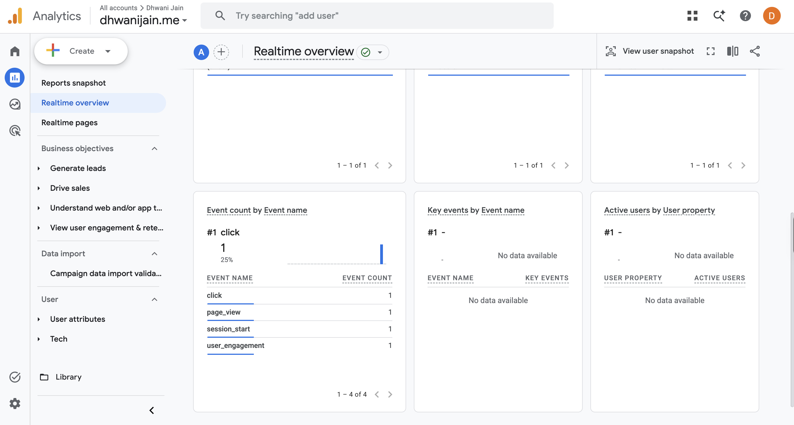
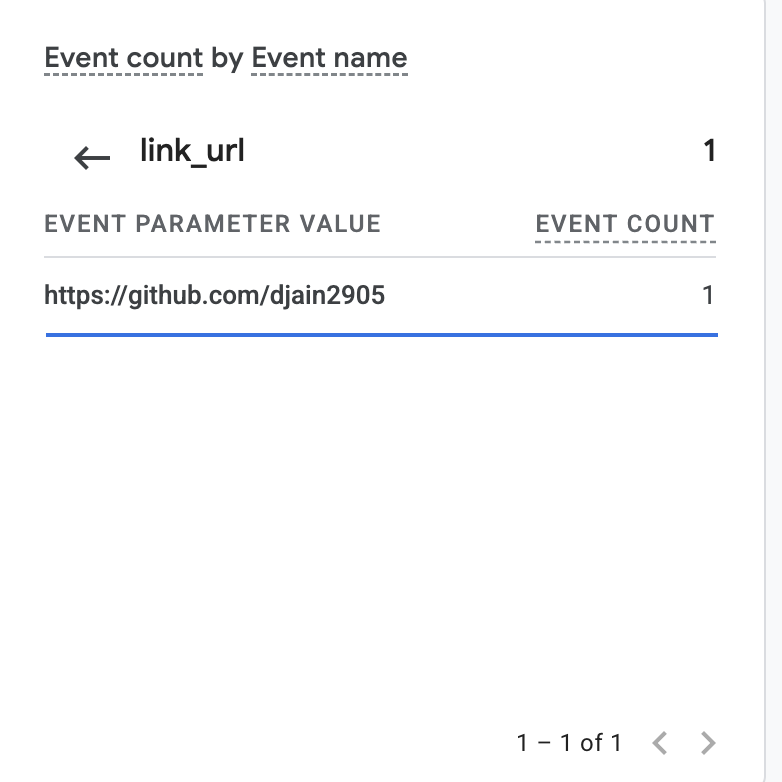
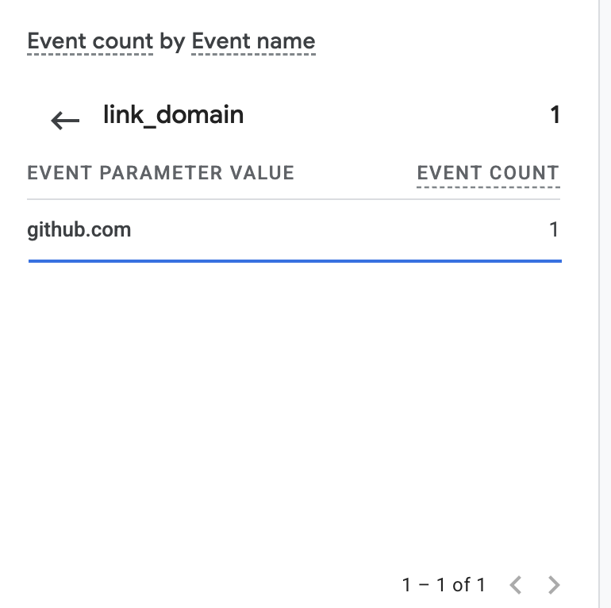
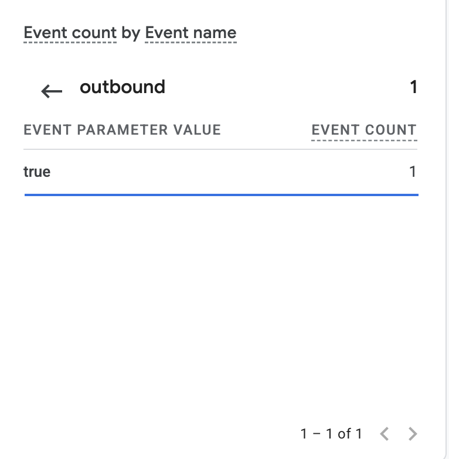

# Exercise 06 — Domain email and Google Analytics

**Repository:** https://github.com/djain2905/career-platform
**Times:** Pacific (America/Los_Angeles)

## 1. Email tests

Mailbox: Zoho Mail, address at `dhwanijain.me`. Outside mailbox: my LMU
Outlook account. Tests run in Zoho webmail and through the Zoho MCP server.

| Test | Time (PDT) | Result |
|---|---|---|
| Received: outside mailbox → domain address ("Test 01: inbound") | 2026-10-13 14:53 | Arrived in the Zoho Inbox. |
| Replied: domain address → outside mailbox ("Re: Test 01: inbound", Zoho webmail) | 2026-10-19 21:06 | Arrived in the outside mailbox's Inbox at 21:06 (not Junk). From shows my `@dhwanijain.me` address. |
| Sent new: domain address → outside mailbox ("Test 02: outbound") | 2026-10-13 14:56 | Arrived in the outside mailbox's Inbox at 14:56 (not Junk). From shows my `@dhwanijain.me` address. |

## 2. SPF, DKIM and DMARC

Source: headers of the reply above, as received by the outside mailbox
(Microsoft 365, LMU Outlook), viewed 2026-10-19. Excerpt with addresses
removed; the domain-level results are unchanged.

```text
Authentication-Results: mx.microsoft.com 1; spf=pass (sender IP is
 165.173.180.52) smtp.mailfrom=dhwanijain.me; dkim=pass (signature was
 verified) header.d=dhwanijain.me;dmarc=pass action=none
 header.from=dhwanijain.me;compauth=pass reason=100
Received-SPF: Pass (protection.outlook.com: domain of dhwanijain.me designates
 165.173.180.52 as permitted sender) receiver=protection.outlook.com;
 client-ip=165.173.180.52; helo=sender6-of-o52.zoho.com; pr=C
ARC-Authentication-Results: i=2; mx.microsoft.com 1; spf=pass ... dmarc=pass
 (p=none sp=none pct=100) action=none header.from=dhwanijain.me;
 dkim=pass (signature was verified) header.d=dhwanijain.me; arc=pass
```

| Check | Result | What it shows |
|---|---|---|
| SPF | pass | Zoho's server (`sender6-of-o52.zoho.com`, 165.173.180.52) is allowed to send for `dhwanijain.me`. |
| DKIM | pass | Signed by `d=dhwanijain.me` with Zoho's `zmail` key, and the signature verified. |
| DMARC | pass | From domain `dhwanijain.me` aligns with SPF and DKIM. Policy is `p=none` (monitor only). |

Test 02 (2026-10-13) had the same SPF and DKIM passes, but Outlook reported
`dmarc=bestguesspass`, which Microsoft gives when a domain has no DMARC
record. The DMARC record was published after that test; the reply on
2026-10-19 shows `dmarc=pass (p=none)`.

## 3. Google Analytics

- Live site: https://dhwanijain.me/
- Privacy page: https://dhwanijain.me/privacy

Observed in GA4 Reports → Realtime overview, property `dhwanijain.me`
(`G-V64QT2T9EG`), on 2026-10-19 at about 21:11 PDT. I loaded
https://dhwanijain.me/ in my own browser and clicked the GitHub link once.

| Event | Parameter | Value seen |
|---|---|---|
| `page_view` | — | count 1 |
| `click` | `link_url` | `https://github.com/djain2905` |
| `click` | `link_domain` | `github.com` |
| `click` | `outbound` | `true` |

The `link_url` matches the GitHub link on the live page.



| `link_url` | `link_domain` | `outbound` |
|---|---|---|
|  |  |  |
