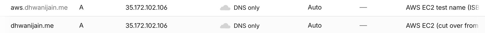
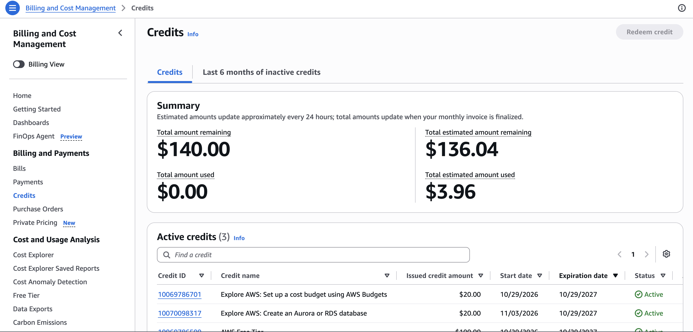

# Exercise 07: Migrate the site from Railway to AWS

Architecture diagram: [README → Architecture → AWS](../../README.md#aws-current-since-2026-11-08).
Full record: [plan](../superpowers/plans/2026-11-03-aws-ec2-rds-migration.md),
[deviation notes](../../migration-notes.md), [test evidence](aws-ec2-rds.md).

## 1. Architecture decision

I chose **EC2 with a Single-AZ RDS PostgreSQL database** over EC2 with PostgreSQL on the instance (and over
Lambda + API Gateway), because I want to learn to run the server without managing the database, and I accept
paying for a second service (about $26.50/month instead of about $13) and losing push-to-deploy.

## 2. Backup record

| | |
|---|---|
| Backup | `pg_dump` (custom format) of Railway Postgres 18.6, **2026-10-29 22:03 UTC**, taken through `railway connect --tunnel-only`. Stored outside the repository |
| Restore test | **Passed.** On 2026-10-29 it was restored into a new local `postgres:18` database, without touching Railway. Row counts, content hashes and all 14 sequences matched, and the app rendered from it. On 2026-11-08 the same file (same SHA-256) was restored into RDS from the EC2 instance in 248 ms, and all 14 table counts matched |
| Data loss I accept (RPO) | **1 day.** RDS takes daily automated backups, kept 1 day (the Free plan's maximum: 7 days was refused). I edit content rarely, by script, and back up before each change |
| Recovery time I accept (RTO) | **1 hour**, to restore the latest dump into RDS from the instance and check the page |

## 3. Verification on `aws.dhwanijain.me` (2026-11-08)

| What I tested | Evidence | Result |
|---|---|---|
| DNS record | `A aws → <EIP>`, DNS only, added with the Cloudflare CLI. A before/after diff showed nothing else changed. `dig @1.1.1.1`, `dig @8.8.8.8` and `nslookup` all return the Elastic IP | Pass |
| HTTPS certificate | Let's Encrypt, `CN=aws.dhwanijain.me`, valid to 2027-02-06. `certbot renew --dry-run`: "all simulated renewals succeeded" | Pass |
| HTTP → HTTPS | `http://aws.dhwanijain.me` returns `301` to `https://aws.dhwanijain.me/` | Pass |
| Live data on the page | `/` returns `200`, no "Showing saved content" banner, projects shown, current role "HUM Nutrition" present | Pass |
| Other pages | `/privacy` 200, `/static/css/styles.css` 200, `/health` `{"status":"ok"}`, `/docs` 404 | Pass |
| Data moved intact | All 14 table counts in RDS match the backup (1/4/5/16/3/8/18/18/2/1/5/0/0/0) | Pass |
| PostgreSQL stays private | RDS is not publicly accessible. Its security group allows 5432 only from the web server's group. Port 8000 is closed from the internet | Pass |
| Encrypted database connection | `sslmode=disable` is refused by RDS. The app uses `verify-full` (TLSv1.3) | Pass |
| Database outage | With the 5432 rule removed, the page returns `503`, keeps the profile and shows "Projects temporarily unavailable". With the rule restored, `200` with no restart | Pass |
| Restart survival | Instance stopped and started: same Elastic IP, site back at `200` with no manual step | Pass |
| Padlock and layout in a browser | Checked in my browser on 2026-11-08: padlock shown, the certificate opens and is valid, and the page looks normal | Pass |

## 4. Cutover status

**Done: `dhwanijain.me` moved to AWS on 2026-11-08 at 23:14 UTC.**
- The apex record changed from `CNAME` to Railway into `A` to the Elastic IP, DNS only. Only that record changed.
- The certificate now covers `dhwanijain.me` and `aws.dhwanijain.me`.
- `https://dhwanijain.me` returns `200` from Nginx on EC2 with the full page.
- `www` still redirects to the root, and the Zoho MX records are unchanged.

Railway's trial had already ended (the site returned `404` from Railway's edge on 2026-11-08), so there was no
rollback target. I made no edits after the 2026-10-29 backup, so it was current.

## 5. Cost

The section 6 estimate, from AWS's public us-east-1 price list on 2026-11-03, is **$26.50/month**:
- EC2 `t3.micro` $7.59
- EBS 16 GB $1.28
- Elastic IP $3.65
- RDS `db.t4g.micro` Single-AZ $11.68
- RDS 20 GB $2.30
- Backups and data transfer $0

**Billing page now (account owner, 2026-11-08):**
- **$140.00** in active credits: $100 at sign-up, plus $20 for setting up a budget and $20 for creating an RDS database.
- **$3.96** estimated used so far, so **$136.04** estimated remaining. AWS updates the estimate about every 24 hours.
- **$0.00** used on finalized invoices.

The account is on the AWS Free plan, so usage comes out of credits, not a card. At $26.50/month, $140 lasts about
5.3 months, and the Free plan ends 6 months after sign-up anyway. A monthly cost budget of $1 emails me at the
first charge credits don't cover. The account ID is cropped out of the screenshot.

